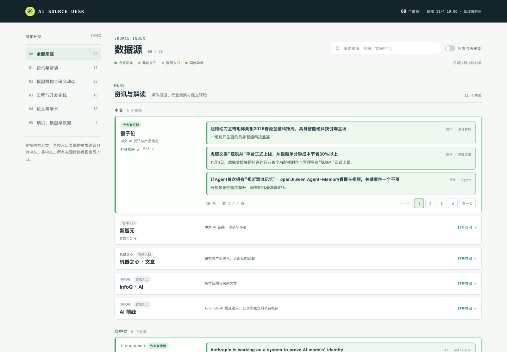

# AI Source Desk

一个面向日常浏览的 AI 信息源看板。**每个来源始终显示**，可以随时直达官网；能稳定自动获取的来源还显示最近标题、发布日期、官网原生分类、发布者导语或摘要、原文链接。每个来源的条目独立分页，今天发布的条目以颜色区分。榜单显示当前快照。历史内容留在原网站阅读。



收录范围按阅读目的分为五类：资讯与解读、模型机构与研究动态、工程与开发实践、论文与学术、项目、模型与数据。每类再按当前入口页面的主要阅读语言分为“中文 / 非中文”，与机构所在地无关；公众号入口也放在对应内容分类中。榜单放在对应的项目与资源目录。`data/sources.json` 同时保留发布者自己的栏目。OpenAI 的 News、Research Index、Developer Blog、Cookbook、Release Notes 和 API Changelog 是六个独立入口。

## 设计原则

- **固定目录**：低频来源、暂无可靠自动列表的官网和公众号入口都保留卡片。默认展示全部来源；“只看今天更新”是临时筛选。
- **逐个来源浏览**：页面直接进入来源目录。每个自动来源的最近条目独立分页；每条文章使用相同版式，官网导语与论文摘要在页面中完整显示已收录的文本。
- **真实线索**：导语与摘要来自发布者公开列表，不做 AI 摘要或主观推荐，也不复制文章全文。部分 RSS 提供的是长正文，采集器会限制预览长度并用省略号标明。
- **明确状态**：`官网入口` 表示仅导航；`等待同步` 表示尚未首次抓取；`同步异常` 表示本轮失败，历史抓取结果仍可见；`今天有更新` 根据文章日期和新加坡时间判断，今天发布的文章另有浅绿色底色。
- **榜单快照**：GitHub Trending 展示当前仓库顺序，绝不把上榜理解为今天创建。其他榜单如无法稳定获取结构化排名，先保留官网入口。
- **来源分类独立**：五个内容分类用于导航；每类下按入口语言分组。官网栏目作为来源标签保留，不强行映射。

## 自动更新

`scripts/update.py` 用 Python 标准库抓取官方 RSS/Atom、Hugging Face 论文与模型目录 API、部分官网公开文章列表，以及 GitHub Trending 和 Artificial Analysis 官网榜单 HTML。其余来源保留官网直达入口。`site/data/latest.json` 是小型快照，只保存每个来源最近少量条目；失败时保留上次成功条目并显示异常。官网列表结构可能变化，解析失败时会标出状态并保留入口。

[`.github/workflows/pages.yml`](.github/workflows/pages.yml) 在每天 **09:17、21:17（新加坡时间）** 自动刷新并部署 GitHub Pages，也可手动运行。定时任务由 GitHub 执行，不需要个人电脑开机。若新来源没有稳定公开接口，先放在目录中，再由 AI 维护者核查后接入。

可选的 [AI 维护工作流](.github/workflows/ai-maintenance.yml) 每周检查快照中的异常，使用 [OpenAI Codex GitHub Action](https://github.com/openai/codex-action) 提出修复 PR，**不会自动合并**。启用时在仓库设置中增加 secret `OPENAI_API_KEY`、variable `ENABLE_AI_MAINTENANCE=true`，并允许 GitHub Actions 创建 PR。AI 的维护规则见 [AGENTS.md](AGENTS.md)。即使未启用 AI 工作流，每日数据刷新仍然独立运行。

GitHub 的定时工作流可能延迟；公开仓库若持续 60 天没有活动，定时工作流可能被自动停用。详情见 [GitHub 文档](https://docs.github.com/en/actions/reference/workflows-and-actions/events-that-trigger-workflows#schedule)。

## 本地运行

不需要安装依赖。Python 3.9+；页面是原生 HTML、CSS 和 JavaScript。

```bash
python3 scripts/update.py --offline          # 初始化/保留本地快照
python3 scripts/build.py                     # 校验来源并复制到 site/data
python3 -m http.server 8000 -d site          # 打开 http://localhost:8000
```

联网刷新全部可抓取来源：

```bash
python3 scripts/update.py
python3 scripts/build.py
```

只重试一个来源：`python3 scripts/update.py --only openai-news`。它会保留其他来源的现有快照。

验证：

```bash
python3 -m unittest discover -s tests
python3 scripts/update.py --offline
python3 scripts/build.py
node --check site/assets/app.js
```

## 发布到 GitHub Pages

将仓库推送到 GitHub，默认分支设为 `main`；在 Settings → Pages → Build and deployment 中选择 **GitHub Actions**。之后推送页面代码会部署站点；计划任务会继续刷新数据并部署。GitHub Actions 需要仓库允许写入 contents，工作流已声明所需权限。部署步骤使用 [GitHub 官方 Pages Actions](https://docs.github.com/en/pages/getting-started-with-github-pages/using-custom-workflows-with-github-pages)。

## 维护来源

编辑 [`data/sources.json`](data/sources.json) 后运行离线更新和构建。每个条目必须有稳定的官网入口。`mode` 取值为 `link`、`feed`、`publisher_page`、`papers`、`papers_trending`、`hf_trending`、`github_trending` 或 `aa_leaderboard`；只有确认官方列表可稳定解析时才将 `link` 改为自动模式。抓取器的网络失败不会删除来源。公众号尽量通过发布者官网中可访问的文章索引进入，不依赖非公开的第三方账号 API。

## 许可与内容

代码采用 [MIT](LICENSE)。来源名称、文章标题、官网导语或论文摘要、分类和链接仅用于索引；原文内容和版权属于各发布者。此项目不代表这些机构，也不重新发布它们的文章。
